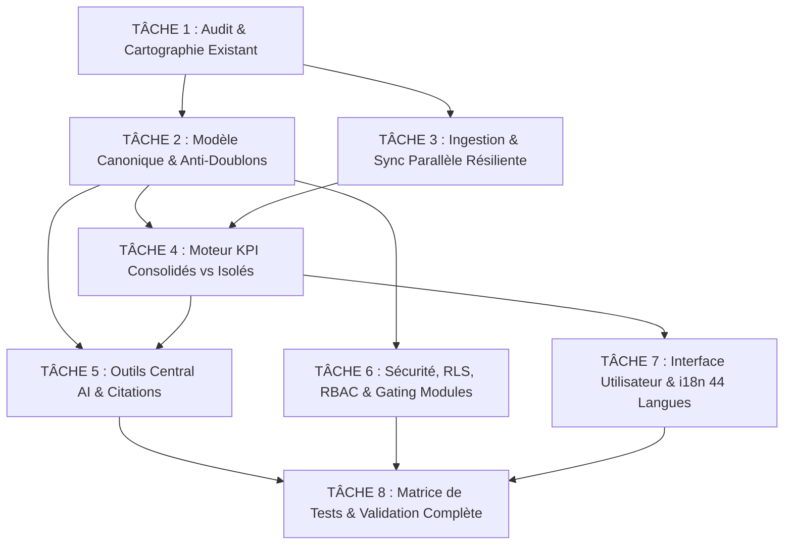

# Architecture du Moteur de Données Multi-Sources Unifiées par Entreprise

> **Statut :** Spécification technique & Plan Directeur avant SANDBOX READY  
> **Auteur :** Antigravity AI Engineering / Avenqo Core Platform  
> **Date :** 2026-10-15  
> **Conformité :** Strictement isolé multi-tenant (RLS PostgreSQL), zéro impact Production, zéro appel payant externe non consenti.

---

## 1. Contexte & Objectif

L'objectif de ce moteur est de permettre à chaque entreprise cliente Avenqo de connecter **simultanément plusieurs boutiques e-commerce (Shopify, WooCommerce, Etsy, Amazon, etc.), plusieurs fichiers et services tiers**, puis de choisir librement si leurs données doivent être analysées **séparément (vue par source) ou ensemble (vue consolidée multi-sources)**.

Les modules Avenqo (**Retail Intelligence, CRM, Marketing, Accounting, Voice Master et Central AI**) doivent pouvoir exploiter ces données unifiées selon leurs permissions respectives, de manière cohérente, traçable et sans ambiguïté.

---

## 2. Découpage Multi-Tâches (Workstreams)

Le projet est découpé en 8 tâches modulaires exécutables en parallèle ou en séquence ordonnée :

---

## 3. Détail des Tâches et Spécifications Techniques

### TÂCHE 1 : Audit et préservation de l'architecture existante
*Conserver l'existant sans reconstruire inutilement (Exigence 13).*

- **Tables existantes réutilisées :**
  - `commerce_connections` : supporte déjà plusieurs connexions par entreprise (`company_id`, `provider`, `external_account_id`, `display_name`, `status`, `sync_cursor`).
  - `commerce_raw_snapshots` : archivage immuable des flux bruts par payload hash (`uq_commerce_raw_snapshot_payload`).
  - `normalized_commerce_records` : stockage normalisé clé-valeur par entité et identifiant source (`connection_id`, `entity_type`, `source_record_id`).
  - `retail_source_states` : états d'activation par clé de source (`company_id`, `source_key`, `enabled`).
- **Évolution de `RetailActiveSource` :**
  - Remplacement de la contrainte unique stricte monoboutique (`uq_retail_active_source_company`) par un modèle de sélection multi-source (`active_sources_scope` : `ALL`, `CUSTOM_SET`, ou `SINGLE`).

---

### TÂCHE 2 : Modèle canonique unifié & Règle d'or anti-doublons
*Normalisation sans fusion arbitraire (Exigences 4 & 5).*

#### Schéma d'entités canoniques
Toutes les entités sont indexées sous une clé composite universelle :
$$\text{Universal Key} = (\text{company\_id}, \text{connection\_id}, \text{entity\_type}, \text{source\_record\_id})$$

1. **Produits (`product`) :**
   - `canonical_id` : UUID v4 déterministe / hash de la clé composite.
   - `sku` : Référence article d'origine.
   - `title`, `description`, `vendor`, `product_type`.
   - `variants` : Liste JSON normalisée (id, barcode, title, price, compare_at_price, sku, inventory_quantity).
   - `source_price` : Montant numérique brut.
   - `currency` : Code ISO-4217 d'origine (CAD, USD, EUR, etc.).
   - `channel` : Nom de la source (`Shopify Boutique A`, `WooCommerce Europe`, etc.).

2. **Commandes & Ventes (`order`) :**
   - `order_number` : Numéro lisible d'origine (ex: `#1042`).
   - `source_created_at`, `source_updated_at` : Horodatages UTC ISO-8601 stricts.
   - `financial_status` : `PAID`, `PARTIALLY_REFUNDED`, `REFUNDED`, `PENDING`, `VOIDED`.
   - `gross_amount` : Montant total brut incluant taxes et livraisons.
   - `discount_amount` : Réductions appliquées.
   - `tax_amount` : Taxes facturées.
   - `refund_amount` : Total des montants remboursés (cumulatif vérifiable).
   - `net_amount` : $\text{gross} - \text{discount} - \text{refund}$.
   - `currency` : Code ISO-4217 de la commande.
   - `line_items` : Tableau normalisé des articles vendus.

3. **Clients (`customer`) :**
   - **Règle absolue anti-doublon et intégrité :**
     > **INTERDICTION DE FUSION ARBITRAIRE :** Un client ayant le même nom ou le même email sur Shopify et sur Etsy reste **deux entités distinctes** dans leurs sources respectives (`connection_id` différent).
     > Une vue analytique peut présenter un indicateur de « Client multi-canal potentiel » sans altérer ni écraser les enregistrements d'origine.
   - `source_customer_id`, `email`, `first_name`, `last_name`, `phone_e164`, `orders_count`, `total_spent`.

4. **Stocks (`inventory`) :**
   - `sku`, `location_id`, `available`, `allocated`, `incoming`.

---

### TÂCHE 3 : Ingestion parallèle résiliente & Circuit Breaker
*Tolérance aux pannes partielles sans blocage global (Exigence 1).*

- **Architecture de synchronisation :**
  - Ingestion découplée par worker asynchrone indépendant (Job par `connection_id`).
  - Si la synchronisation d'Etsy échoue (taux d'erreur 429 ou token expiré), le job passe en statut `ERROR` / `REAUTH_REQUIRED`, tandis que les synchronisations de Shopify et WooCommerce continuent sans interruption.
  - Déclencheur parallèle `asyncio.gather(*tasks, return_exceptions=True)` ou queue Redis/PostgreSQL avec isolation par transaction.
- **Idempotence stricte :**
  - Calcul du hash SHA-256 de chaque payload brut dans `commerce_raw_snapshots`.
  - Si le hash est inchangé depuis le dernier snapshot, la normalisation est court-circuitée (`304 Not Modified`), économisant les CPU et les I/O de base de données.
  - Sauvegarde incrémentale guidée par le curseur `sync_cursor` (ex: `updated_at_min`).

---

### TÂCHE 4 : Moteur analytique & KPI consolidés vs isolés
*Calcul exact, conversions monétaires, remboursements et provenance (Exigences 3 & 6).*

1. **Sélecteur dynamique de portée :**
   - Mode `SINGLE_SOURCE` : `WHERE company_id = :comp_id AND connection_id = :selected_conn_id`
   - Mode `CONSOLIDATED` : `WHERE company_id = :comp_id AND connection_id IN (:active_conn_ids)`
   - Prise en compte du flag d'activation de la source (`retail_source_states.enabled = TRUE`).

2. **Conversion monétaire explicite :**
   - Chaque entreprise dispose d'une devise pivot de référence (`company.base_currency`, ex: `CAD`).
   - Si une boutique vend en `USD` ou en `EUR`, le moteur applique la table des taux de change historiques à la date de la transaction (`source_created_at`).
   - La formule de conversion est documentée et exposée dans les métadonnées du KPI :
     $$\text{Amount}_{\text{base}} = \text{Amount}_{\text{source}} \times \text{ExchangeRate}(\text{source\_currency} \to \text{base\_currency}, \text{date})$$
   - Le montant brut d'origine et la devise source restent toujours consultables (provenance immuable).

3. **Traitement strict des remboursements :**
   - Le Chiffre d'Affaires Net (Net Sales) déduit systématiquement les retours et remboursements horodatés.

---

### TÂCHE 5 : Central AI & Citations de provenance
*Interrogation unifiée transparente dans la même conversation (Exigence 7).*

- **Paramètres des outils IA (`commerce_tools.py`) :**
  - Ajout du paramètre optionnel `source_scope` : `["all"]`, `["conn_shopify_1"]`, ou liste d'identifiants.
- **Citations de provenance automatiques :**
  - Chaque réponse de Central AI mentionne précisément la ou les boutiques ayant fourni les données :
    > *« Sur la période du 1er au 15 octobre, vos ventes consolidées atteignent 42 500 CAD (dont 28 000 CAD sur **Shopify Boutique Principale** et 14 500 CAD convertis depuis 10 700 USD sur **Shopify USA**). 3 retours pour un montant de 340 CAD ont été déduits sur la boutique USA. »*

---

### TÂCHE 6 : Sécurité, RLS, RBAC & Gating Multi-Modules
*Isolation étanche, séparation lecture/écriture et contrôle des droits (Exigences 8, 9 & 10).*

1. **Séparation Lecture / Écriture :**
   - Par défaut, toutes les connexions sont autorisées en **LECTURE SEULE** (`READ_ONLY`).
   - Tout ordre d'écriture (ex: modification de stock ou de prix sur Shopify) requiert le scope explicite `write_inventory` / `write_orders` ET une validation humaine explicite dans l'interface (Human-in-the-loop).

2. **Gating des modules métier :**
   - **Retail Intelligence :** Débloqué si le module `retail` est actif dans les entitlements de l'entreprise.
   - **CRM :** Accès aux contacts clients seulement si `crm` est actif.
   - **Accounting :** Accès aux écritures de vente et taxes seulement si `accounting` est actif.
   - **Voice Master :** Interrogation vocale des stocks ou commandes seulement si `voice` est actif et si les autorisations vocales (`voice_module_permissions`) l'autorisent.

3. **PostgreSQL Row-Level Security (RLS) :**
   - Politiques RLS `FORCE` sans exception :
     `CREATE POLICY tenant_isolation_policy ON <table_name> USING (company_id = current_setting('app.current_company_id')::uuid);`
   - Test d'étanchéité multi-tenant intégré dans la suite de régression de sécurité.

---

### TÂCHE 7 : Interface Utilisateur & Contrôles Traduits (44 Langues)
*Contrôles intuitifs et internationalisation intégrale (Exigences 3 & 11).*

1. **Composants d'interface (Web Next.js & App Flutter) :**
   - **Barre supérieure de sélection de source :**
     - Menu déroulant avec statut de connexion (pastille verte/orange/rouge).
     - Options : *« Vue consolidée (Toutes les sources) »*, *« Sélection multiple personnalisée »*, ou *« [Nom de la boutique] »*.
   - **Panneau de configuration des sources (`/workspace/sources`) :**
     - Liste de toutes les boutiques connectées avec date de dernière synchronisation.
     - Interrupteur (toggle) : *« Inclure dans les KPI globaux »*.
     - Gestion des droits d'accès par rôle utilisateur (Admin, Manager, Lecture seule).
2. **Internationalisation (44 langues) :**
   - Ajout des clés canoniques dans les dictionnaires JSON de traduction (`frontend/messages/*.json`) :
     - `sources.all_sources` (Tous les canaux / All sources)
     - `sources.consolidated_view` (Vue consolidée)
     - `sources.single_source` (Vue par source)
     - `sources.sync_success`, `sources.sync_in_progress`, `sources.sync_failed`
     - `sources.include_in_kpis`, `sources.exclude_from_kpis`
     - `sources.currency_conversion_notice`

---

### TÂCHE 8 : Matrice de Tests & Validation Rigoureuse
*Scénarios d'essais exhaustifs sans impact de production (Exigences 12 & 14).*

1. **Test de synchronisation concurrente :** 3 boutiques synchronisées simultanément via `asyncio` sans blocage de thread ni timeout.
2. **Test de tolérance aux pannes partielles :** Simulation d'une coupure réseau sur la source 2 ; validation que les sources 1 et 3 se terminent en statut `READY` et alimentent les KPI.
3. **Test d'idempotence et d'anti-doublon :** 3 exécutions consécutives du même flux ; le nombre de lignes dans `normalized_commerce_records` reste strictement constant.
4. **Test de non-fusion arbitraire :** 2 clients avec le même email `client@example.com` sur 2 boutiques différentes créent bien 2 enregistrements distincts et traçables.
5. **Test de calcul consolidé multi-devises :** 1 commande de 100 CAD + 1 commande de 100 USD (taux 1.35) = 235 CAD consolidés avec preuve de calcul.
6. **Test d'étanchéité inter-entreprises :** L'entreprise B interroge l'API ; 0 ligne de l'entreprise A n'est retournée (contrôle RLS PostgreSQL).

---

## 4. Garanties & Règles d'Engagement

- **Production Intouchable :** Aucun code, aucun rôle, aucune table ni aucune migration n'est appliquée en Production.
- **Zéro dépense fournisseur :** Aucun appel API tiers facturé n'est exécuté ; utilisation exclusive de stubs et de simulateurs contractuels.
- **Déploiement Sandbox sous contrôle :** Les déploiements sont strictement subordonnés à la réussite complète de la CI et à l'autorisation formelle du propriétaire.
